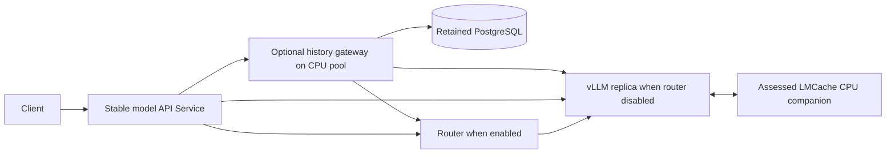

<!-- Copyright (c) 2020-2022 Oracle and/or its affiliates. All rights reserved. -->
<!-- Licensed under the Universal Permissive License v 1.0 as shown at http://oss.oracle.com/licenses/upl. -->
# Recipe-driven caching, routing and conversation state

Status: initial generic LMCache/routing implementation completed locally; runtime store/retrieve and multi-replica validation pending.
History implementation remains a separate follow-on decision.
Evidence date: 2026-11-16. Scope: extend the existing model deployment stack,
reusing its independent model lifecycle, trusted onboarding and native Helm delivery.

## What exists today

| Capability | Repository and observed deployment |
| --- | --- |
| Runtime KV cache | Present in vLLM. The current Qwen deployment logs report GPU KV usage. |
| Reuse of prefixes across requests | The adapter preserves recipe arguments but does not establish an explicit tested caching policy. Recent logs show 0% prefix hits; random benchmark prompts and short chats do not prove caching is disabled or broken. |
| CPU/disk/shared KV caching | Not provisioned by this adapter. Cache server resources are disabled; preflight rejects declared companions. |
| Routing | Pinned production-stack 0.1.14 router, configured for prefix-aware routing. Enabled for multiple replicas or an autoscaling maximum above one; optional with one replica. No KV-event integration. |
| Current live topology | Qwen/Qwen3.8-27B, one replica, TP=4, PP=1, 4096-token context, concurrency=4; direct ClusterIP. Four GPUs cooperate on one replica; they are not four routing targets. |
| Conversation history | Clients can send prior messages. The stack explicitly advertises no durable Responses/conversation persistence. |

Source anchors: `modules/llm-deployment/model-delivery/main.tf`,
`outputs.tf`, `scripts/preflight.sh`, `scripts/common.sh`,
`chart/templates/_helpers.tpl`; `modules/discovery/serving-resolution/main.tf`;
`modules/discovery/deployment-planner/recipe-api.tf`.

The GPU KV cache holds inference state. Prefix caching reuses computation when
requests share an identical token prefix; it primarily saves prefill work, not
per-token decoding. History stores messages, tool calls and responses so they
can be retrieved and replayed after a process restart. These are separate data
lifecycles. Losing a cache must affect performance, not lose a conversation.
See [vLLM prefix caching](https://docs.vllm.ai/en/stable/features/automatic_prefix_caching/).

Additional read-only image inspection found LMCache 0.5.3 already installed in
the current serving image, including its external MP connector module. vLLM
reports development build `0.1.dev19754+g3a0914114`. This removes the need to
assume a package install, but does not prove connector/runtime compatibility.
The implementation must assess this exact image and LMCache MP protocol against
the pinned production-stack router/controller integration before activation.

## Users and acceptance stories

- Model deployer: choose an assessed recipe and deploy its required companions,
  settings and probes through the existing model Apply, with no manual installs.
- Application developer: use the existing Chat Completions endpoint unchanged,
  or opt into Responses/conversation IDs for server-maintained history.
- Model operator: see effective cache configuration, cache hit/retrieval evidence,
  routing placement, history persistence status and resource limits separately.
- Platform owner: reuse the cluster, GPU pool and shared controllers; retain
  durable data through model upgrades and explicit undeploy.

Important stories: repeat a long system/document prefix without repeating its
prefill; continue a conversation after restarting the gateway; scale from one
to several replicas without changing the application URL; remove a model's
workloads without deleting its history or shared platform services.

## Full scope and first delivery

The full design covers native prefix reuse, bounded host-memory offload, optional
disk and shared cache tiers, selectable prefix-aware/KV-aware routing, durable conversation APIs,
retention/deletion, observability, correctness tests, and lifecycle/recovery.

Recommended first delivery includes native prefix caching, one assessed LMCache
CPU-tier adapter, the existing router with explicit prefix-aware and KV-aware
choices, and optional durable history through an
upstream gateway plus PostgreSQL. Include both model-owned PostgreSQL on a
retained PVC for a self-contained deployment and an existing external PostgreSQL
binding for production. The former is single-instance and not database HA.
Do not describe its PVC as a backup; require a verified backup/restore path before
calling the history deployment production-ready.

Delivery order: implement and validate LMCache first on one replica, then add
and validate routing selection across multiple replicas, then implement history.
A smaller model is suitable for routing tests if multiple replicas fit retained
GPU capacity. Do not assume TP=4 provides four independent routing targets.

Defer shared cross-replica cache storage, disk tiers, KV-event scheduling,
prefill/decode disaggregation, RAG/vector stores, automatic summarization,
and long-term semantic memory. None is required to provide useful caching and
persistent multi-turn conversations with one model replica.

## Options and recommendation

| Approach | Benefit | Cost / limitation | Decision |
| --- | --- | --- | --- |
| Native vLLM prefix reuse only | Smallest change; no companion required | GPU-local, evictable; no offload or history | Foundation for every supported recipe |
| Add LMCache with an assessed CPU companion | Reuse prefixes beyond GPU-resident capacity | Host RAM, connector and hybrid-layout compatibility must be tested | First cache extension; selectable by recipe |
| Replace delivery with llm-d/Dynamo and distributed cache | Broader scheduling and serving strategies | Larger platform/controller changes and ownership migration | Future adapter, not prerequisite |
| Keep history in each client | Existing Chat Completions works | No stack-owned durable continuation | Continue supporting |
| Upstream stateful gateway plus PostgreSQL | Standard Responses/conversation APIs; independent persistence | Additional CPU/database lifecycle; release compatibility and ownership gates | Recommended history option |
| Write a custom conversation server | Exact control | Protocol, streaming, migrations and correctness maintenance | Avoid unless upstream evaluation fails |

Gateway candidate: [vLLM Agentic API](https://github.com/vllm-project/agentic-api).
Its [Kubernetes design](https://github.com/vllm-project/agentic-api/blob/main/docs/deploying/kubernetes.md)
uses PostgreSQL independently of inference. Evaluate a tagged, digest-pinned
release, not development documentation alone. Its
[version-pinned API contract](https://github.com/vllm-project/agentic-api/blob/b0f491e024ff73339b16e6f83a301041a51257d7/docs/api/index.md)
includes Chat Completions pass-through and Responses/conversations. That contract
also documents default-tenant conversation ownership: authentication alone is
not proof of caller isolation. First delivery may expose it only inside one
explicit trusted application boundary; independent-user access requires verified
principal-scoped authorization in the selected release or an enforcing adapter.
Disable gateway-owned tools, arbitrary outbound tool execution, files and vector
stores in the initial profile. No silent fallback to an in-memory history store.

## Production-stack, llm-d and conversation history

Production-stack and llm-d are distinct inference stacks. This repository uses
production-stack's Helm router; it does not install llm-d. Adopting llm-d is not
necessary to add the requested router options or durable history.

The [llm-d stateful Responses guide](https://llm-d.ai/docs/well-lit-paths/foundations/serve-responses-api)
adds vLLM Agentic API and PostgreSQL in front of the llm-d router. Its inference
requests still carry replayed context. That is the same architectural separation
recommended here: durable state belongs to the API layer and database; inference
routing selects a model replica. Reuse the upstream stateful API integration
rather than implement history in the router. Evaluate pinned releases and the
ownership/migration requirements described above.

## Routing selection after LMCache

Expose `routing_mode = auto | direct | prefixaware | kvaware` in the assessed
profile, model Terraform declarations, RMS schema and effective outputs.

| Mode | Behavior and dependencies |
| --- | --- |
| auto | Direct for one replica; prefix-aware for multiple replicas/autoscaling maximum above one. Preserve the existing default. |
| direct | Single-replica path; reject if fixed replicas or autoscaling maximum exceeds one. |
| prefixaware | Explicit router, including with one replica; estimates locality from prompt prefixes. |
| kvaware | Explicit router plus compatible LMCache controller/index and reporting workers; uses reported cache locations. |

Keep the old `router_enabled` input backward-compatible; reject contradictory
explicit choices instead of silently overriding them. Choosing either router
mode starts the router even with one replica. One replica can validate wiring,
streaming and health, but cannot demonstrate backend selection.

Production-stack's existing KV-aware integration queries the LMCache controller;
it is not the same implementation as adding a vLLM KV-event subscriber. The
[pinned chart's reference configuration](https://github.com/vllm-project/production-stack/blob/405a2fa79992754d31f754c31b1eabb7183a540e/tutorials/assets/values-17-kv-aware.yaml)
wires controller ports, worker reporting and the router. Test this exact router
against the selected LMCache connector/server protocol; an old reference image
is not a compatible default for Qwen3.8 just because its Helm values render.

KV-aware selection must provision all required model-owned components, generate
unique worker/replica instance identities, register reachable leader endpoints,
and remove stale registrations on rollout or failure. Do not publish unready
workers or TP ranks as independent serving replicas. Verify controller readiness
and worker registration before declaring Apply successful. Detect stale cache
information and expose misses, controller errors and fallback separately.
Distinguish the controller reporting no cache holder (normal cache miss) from an
unreachable/unhealthy controller. Use only a documented, tested runtime fallback
policy; never silently claim KV-aware placement while operating as prefix-only.

The LMCache controller here is a namespaced runtime service, not a new
cluster-wide Kubernetes operator. Keep it model-owned unless a separately
reviewed shared platform service is explicitly selected. Disk/shared KV storage
and additional routing policies remain later work.

## Target topology and ownership



The Service selects exactly one ingress path for the selected profile; the
arrows show alternatives, not requests dispatched simultaneously. Gateway to
router to serving endpoints when history and routing are enabled; direct
inference when neither is enabled. Reuse the existing service name and port via
an explicitly validated selector/target-port transition, or provide a documented
one-time endpoint migration if preserving it is unsafe. Backend engine Services
remain internal; health checks and benchmarks must exercise the advertised path.

Model ownership includes the gateway, router, cache companions, namespaced
configuration, model-owned database workload, and validation Jobs. Infrastructure
continues to own shared controllers and retained GPU pools. An external database
is only bound by secret reference and connectivity configuration. Gateways,
database Pods and standalone CPU helpers use CPU pools; a cache sidecar may
need to share the serving worker's GPU host for memory/IPC locality, with its
own CPU/RAM budget and no GPU request. The assessed connector determines the
placement, shared-memory/socket volumes and TP/PP worker layout; do not assume
one arbitrary cache server works for every topology.

## Recipe and deployment contract

Preserve the upstream recipe and assessed Hugging Face/image provenance.
Resolve a versioned deployment profile beside that recipe for platform services
that upstream recipes do not describe. A requested feature resolves to a supported
adapter with a schema, images, resources, dependencies, configuration files,
readiness checks and a validation scenario. Never run arbitrary commands or fetch
unreviewed charts just because a recipe mentions a companion.

Proposed effective contract, illustrative rather than final field names:

```yaml
schema_version: 'next'
deployment_profile:
  cache:
    prefix: enabled       # assessed engine/model support required
    tier: lmcache_cpu     # or gpu_only; disk/shared tiers follow later
    adapter: assessed-profile-id
  routing:
    mode: auto            # auto, direct, prefixaware, or kvaware
  history:
    mode: responses_postgres  # or disabled
    database: model_owned     # or external_secret
    retention_policy: deployment-selected
```

The assessed profile resolves actual immutable image/chart digests, connector
config, memory and block geometry. Do not place placeholders in a generated
runnable bundle. The deployment schema exposes the resolved defaults and
supported alternatives. User inputs override recipe recommendations through
normal Terraform/RMS declarations and named pipeline parameters where reruns
are safe; no hidden tfvars. Platform policy constrains choices. Required recipe
features cannot be disabled while leaving dependent flags behind: reject the
combination or select a complete alternate assessed profile.

Normalize feature flags once, reject conflicting raw recipe/manual flags, and
freeze the resolved configuration in the generated model bundle. Settings that
change workers or companions participate in deployment generations. A history
retention/backup policy is an environment choice, not an inferred model property.
Secrets are references to existing Kubernetes/Vault mechanisms, never recipe
values, inline command text, Terraform-managed plaintext passwords or log output.

Older bundles retain existing behavior until explicitly upgraded. New recipes
recommend native prefix caching when validated; recommend LMCache CPU offload
only after the exact model/image/connector/topology is validated. History is an
explicit selection because it stores user data. Unsupported requested profiles
fail before Helm rather than quietly disabling a selected feature.

## Cache correctness and sizing

Qwen3.8 is a hybrid full-attention/GDN model. Upstream
[LMCache model guidance](https://docs.lmcache.ai/recipes/qwen3_5.html)
includes this model but records particular tested geometries. Its one-GPU
example does not validate our four-GPU TP deployment. Determine the actual
worker block sizes and recurrent-state behavior from the pinned image and test
store/retrieve correctness. Do not copy current documentation's flags or block
sizes unconditionally into another release.

Follow the [LMCache compatibility guidance](https://docs.lmcache.ai/getting_started/compatibility.html):
pin runtime ABI, connector implementation, server protocol, model layout and
parallelism together. Preserve the current serving image if compatible; otherwise
present an explicit assessed image change. No runtime package installation or
model-specific container patching.

Budget host cache memory in addition to existing 16Gi worker memory and 8Gi
memory-backed shared space. Account for all worker processes, sidecars, packed
replicas, autoscaling maximum, and Kubernetes memory pressure. File tiers need
separate volumes/budgets from model weights and ephemeral checkpoint workspace.
Show cache bytes and estimated token capacity where the model layout is known;
label hybrid estimates unverified until measured. Do not assume uniform
attention or linear KV division across TP ranks.

Cache identity includes resolved model/tokenizer/chat-template revision, adapter
and LoRA identity where applicable, KV dtype, engine/connector format and
parallel layout. Isolate model releases and trust domains. A moving `main`
reference cannot safely identify a retained shared cache: use the resolved
runtime commit or invalidate cache at the execution boundary. Never make
`main` a prerequisite. Cache eviction/outage may recompute safely when the
connector supports it; corruption/layout mismatch must fail validation.

## History semantics and bounded work

Chat Completions stays stateless: the caller sends `messages`. Stored history is
provided through Responses/conversation APIs; it is not silently injected into
unrelated Chat Completions calls. Preserve roles, tool-call IDs and tool results,
model-visible reasoning fields where supported, and message order. Check the
selected model's chat template against replayed items. Do not treat readable
reasoning text as a portable hidden-state format.

Bind history to model/API profile version. A model/template change requires an
explicit compatible continuation policy, a new conversation, or a clear error;
it must not silently reinterpret stored turns. Persist completed turns with
well-defined failed/partial/streaming states. Bound concurrent writes per
conversation and verify duplicate-request behavior; never blindly retry an
inference request after streaming has started. Expired, deleted and unknown IDs
return documented errors, not a fresh conversation.

Set TTL and maximum stored bytes/items per conversation and trust domain.
Enforce actual tokenized replay plus output allowance against the selected
context window (currently 4096). Start with a clear context-limit error, not
silent truncation of system messages or tool pairs. Automatic summarization is
later, opt-in work because it changes meaning. Replaying T tokens costs O(T)
in tokenization and has attention/prefill costs dependent on the model; a history
ID does not remove that work. Prefix reuse reduces recomputation for unchanged
prefixes. Use stable ordering, paginated history reads and bounded request bodies
rather than loading unbounded histories into gateway memory.

Deleting a conversation and deleting a response may have different upstream
semantics; define and test user-data deletion across all stored records, backups
and retention windows. Use encryption, explicit authenticated access boundaries,
restricted database permissions and no prompt/body logging by default. Do not
claim independent-user isolation without negative authorization tests.

## Phased implementation and acceptance

### Phase 0: Pin the supported combinations

- [x] Audit repository and live deployment without changing workloads.
- [x] Compare upstream cache/router/stateful API approaches.
- [x] Establish immediate order: LMCache first, prefix/KV routing selection next.
- [ ] Confirm history storage/access defaults before implementing history.
- [ ] Record serving/LMCache/gateway/router/PostgreSQL image and chart digests,
  release source commits, GPU/CPU architecture and current model revision.
- [ ] Test native prefix reuse and LMCache on the exact TP=4 Qwen image. Use
  repeated prefixes longer than the resolved hybrid block boundaries; compare
  cold/warm/cache-retrieved outputs and engine counters. Test text first; do not
  label multimodal reuse supported without its own tests.
- [ ] Evaluate tagged gateway persistence, streaming, tool-item replay,
  ownership, deletion and upgrade/migration behavior.

Exit: a tested compatibility matrix, or an explicit blocked feature with
concrete alternatives. No unsupported defaults promoted on version numbers alone.

### Phase 1: Carry service requirements through recipe resolution

- [ ] Extend the assessed recipe/deployment profile schema and resolver.
- [ ] Replace blanket companion rejection with an allowlist of complete adapters;
  continue rejecting incomplete or unknown companions.
- [ ] Freeze profile/dependencies/resources/provenance in the selection and bundle.
- [ ] Add editable RMS/Terraform declarations for cache tier/budget, routing and
  history/database/retention; outputs show effective status and validation level.
- [ ] Test old bundles, defaults, conflicts and unsupported combinations.

Exit: a generated model ZIP carries a complete, reproducible service plan.

### Phase 2: Deploy useful cache tiers with one replica

- [ ] Render supported native caching args and connector configuration once.
- [ ] Add assessed cache ConfigMaps, sidecars/Services, socket/shared-memory
  mounts and resources to Deployment and supported LWS worker templates.
- [ ] Verify CPU/RAM placement and explicit failure/recompute behavior.
- [ ] Publish cache hit, eviction, host-memory, transfer and prefill latency metrics
  through existing monitoring. Add a repeated-prefix benchmark scenario; random
  independent prompts are not a cache-effectiveness benchmark.

Exit: demonstrable correct prefix reuse and host-tier retrieve on the selected
profile, including cache restart/eviction. No newly allocated or recycled GPUs.

### Phase 3: Implement selectable prefix-aware and KV-aware routing

- [ ] Add `auto`, `direct`, `prefixaware` and `kvaware` choices through the
  recipe/profile, Terraform, RMS schema, pipeline configuration and outputs.
  Keep `auto` direct for one replica and prefix-aware for scale-out.
- [ ] For KV-aware mode deploy the compatible LMCache controller and configure
  worker reports, unique instance identities, reachable leader endpoints and
  router lookup ports. Add readiness/registration checks and cleanup.
- [ ] Test a controller-reported miss separately from controller failure and
  stale registrations, and verify the advertised fallback behavior.
- [ ] Keep leader-only model selectors and exclude workers/other model releases.
- [ ] Verify discovery, draining, failed-backend removal, SSE forwarding and
  latency/load behavior. Preserve caller routing headers through the gateway.
- [ ] Validate with already-retained GPU slots when an approved second replica
  fits; otherwise record multi-replica runtime validation as pending.

Exit: routed requests and cache-locality behavior demonstrated; metadata or a
successful Helm render alone is not routing validation. KV-event scheduling
remains a later independently assessed adapter upgrade.

### Phase 4: Add durable conversation state

- [ ] Package the selected upstream gateway as a model-owned Helm component.
- [ ] Support model-owned PostgreSQL/retained PVC and an external secret binding;
  validate capacity, storage, TLS, credentials references and connectivity.
- [ ] Implement supported migration sequencing, readiness, retention, backup and
  restore, and explicit database lifecycle/ownership checks.
- [ ] Expose gateway as the selected stable API path, forwarding stateless API
  calls to the router or direct engine.
- [ ] Test continuation after gateway restart and across gateway replicas,
  database outage, concurrent turns, tool results, SSE cancellation, request
  duplication, context overflow, expired IDs and unauthorized access.

Exit: conversation history survives gateway and serving restarts; cache loss
only changes performance. No history claim from health checks alone.

### Phase 5: Integrate Apply, validation, teardown and archives

- [ ] Reuse trusted onboarding and the existing model operation Lease. Grant only
  required namespaced resource types; no model-owned cluster administration.
- [ ] Apply checks durable dependencies, prepares database/schema, deploys cache
  prerequisites and serving/router/gateway in their explicit dependency order,
  then runs separate end-to-end validation and waits for terminal success.
- [ ] Keep independent prerequisites parallel and fail Apply on failed children,
  failed migrations or selected-feature validation. Exclude volatile metrics
  and inventory from meaningful deployment revision hashes.
- [ ] Preserve manual benchmark/validation/undeploy pipelines. Native Helm owns
  releases; Shell handles prerequisites, validation and explicit teardown.
- [ ] Undeploy removes only owned workloads and ephemeral KV state; retains
  history PVCs/external databases and shared controllers. Data purge and backups
  have explicit separate operations. Rollbacks must respect schema compatibility.
- [ ] Run focused executable regressions, Terraform tests, Helm render/schema
  checks and Terraform 1.5.7 checks on generated RMS archives. Verify inline
  command sizes and actual provider/runtime behavior. Build from committed
  source, integrate only after relevant validation, rebuild after merging.

Exit: recipe to generated model ZIP to RMS Apply to successful cache/history
requests to retained-data undeploy is verified. Metadata-only changes get a
live plan review proving no GPU pool mutations; serving changes use a bounded
workload rollout on the retained pool, with expected one-replica downtime stated.

## Current validation record

This change contains a plan only. Repository inspection and read-only Kubernetes
queries confirmed current replica count, serving arguments, direct Service and
runtime GPU KV usage. No cache-effectiveness experiment, recipe integration,
gateway/database deployment or GPU mutation was performed for this plan.

Immediate priority confirmed by the user: LMCache integration first, then
selectable prefix-aware/KV-aware routing. Native/CPU-tier caching is promoted
only for tested profiles. History remains follow-on scope, reusing an upstream
API gateway/database integration inside an explicit trusted application boundary
until principal-scoped ownership is proven. No application feature is implemented
by this planning update.


## Implementation ledger: LMCache and routing

- [x] Add recipe/profile resolution and RMS/Terraform routing/cache inputs.
- [x] Render MP launcher, in-process controller reporting, memory budgets and router ports.
- [x] Validate launcher lifecycle, manifest behavior and rejection of incompatible combinations.
- [ ] Run Terraform regression and generated RMS archive checks.
- [ ] Record exact runtime compatibility and remaining multi-replica validation.

Initial MP adapter is single-host TP, one disposable host tier per serving Pod.
The pinned router KV-aware protocol uses the in-process adapter. Selecting KV-aware
with MP is rejected explicitly rather than pretending the two controller protocols
are interchangeable. Full cache store/retrieve performance requires a manual
cache benchmark; health checks do not assert cache hits.


Implementation evidence (2026-11-16): generic fixtures cover ordinary attention
profiles and optional recurrent-cache policy, preserve existing native prefix
flags, propagate profiles through discovery and publication, and keep profile
recommendations editable in RMS. There are no model-name branches or fixed hybrid
block sizes in the adapters. Unsupported MP/KV-controller and multi-host layouts
are rejected, not advertised as compatible.

Model delivery Terraform tests: 43 passed; serving resolution: 15 passed;
deployment planning: 54 passed; model publisher: 8 passed. Focused launcher/chart
checks exercise failure propagation, literal argument handling, worker identity,
no extra GPU requests and actual pinned-router controller Service ports.
The live image's LMCache server CLI accepted the implemented MP flags. Subsequent
cluster reads returned Bad Gateway through the configured connection, so no new
live model rollout, store/retrieve result or multi-replica placement is claimed.
No GPU resource was allocated, resized, recycled or deleted.

Final focused executable validation: 44 combined model/client/launcher/chart
checks passed, plus the new cache-readiness regression passed separately. The
pinned router chart was supplied for real Helm rendering (no optional router
check skipped). Cache metrics are exposed through the existing model Service and
ServiceMonitor. Existing compatible recipe KV-transfer settings are retained
once, with conflicting endpoints rejected. One intermediate Terraform run read
chart files while they were being edited and failed its source-hash consistency
check; the complete rerun against unchanged source passed all 43 checks.
